# DUI-1a visual checks

The working screens use a fresh fictional practice job. Screenshots were taken in Chromium at 360 × 800 and 1280 × 800. Review and customer/site screenshots are taken at their panels in Work.

The comparison column uses the matching catalogue states from the [16 October interface candidate](https://github.com/ben2harwood-lgtm/jobguard/tree/7b909f72b48558facaf483755ea282e592a800e0). The approved standalone clickable HTML was unavailable in the workspace. The candidate includes generic specimens for v075, v076 and v077, with an interactive Quotes companion. The working screens use the approved style tokens and components already ported on main.

## 360px

| Step | Working screen | 16 October preview candidate |
| --- | --- | --- |
| Capture and cited draft | [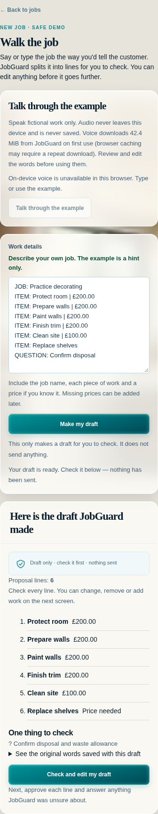](mobile-360-capture.png) | [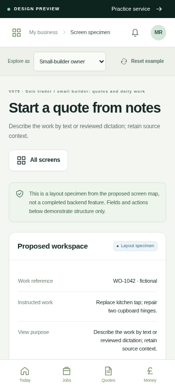](mobile-360-reference-capture.png) |
| Scope review | [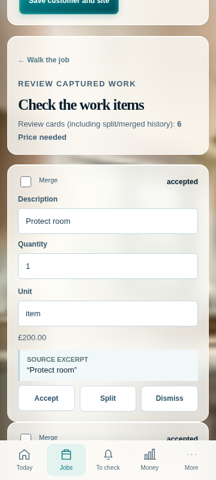](mobile-360-scope-review.png) | [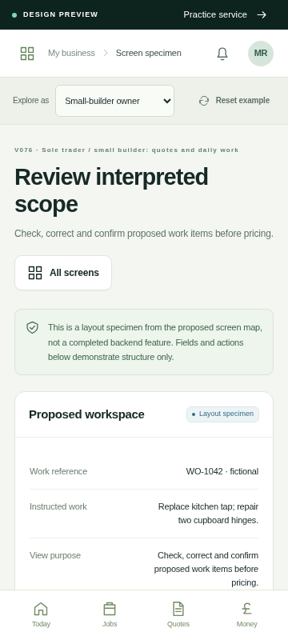](mobile-360-reference-scope-review.png) |
| Scope confirmed | [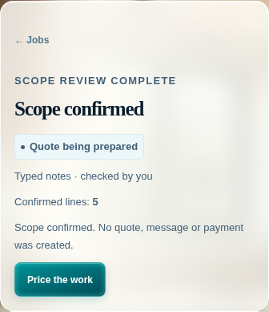](mobile-360-scope-confirmed.png) |  |
| Customer and site | [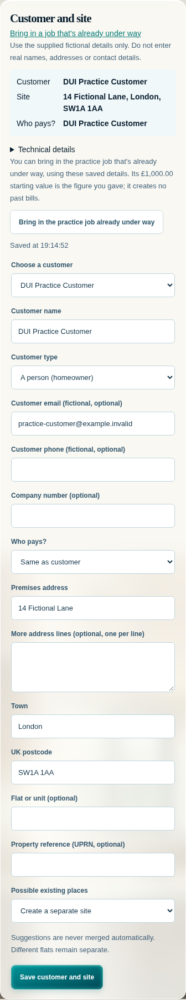](mobile-360-customer-and-site.png) | [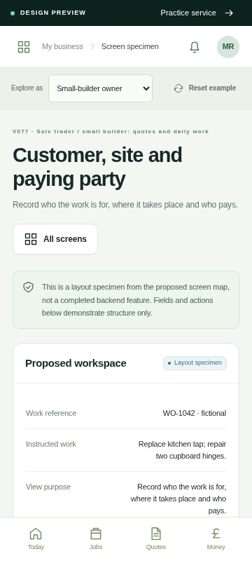](mobile-360-reference-customer-and-site.png) |

## 1280px

| Step | Working screen | 16 October preview candidate |
| --- | --- | --- |
| Capture and cited draft | [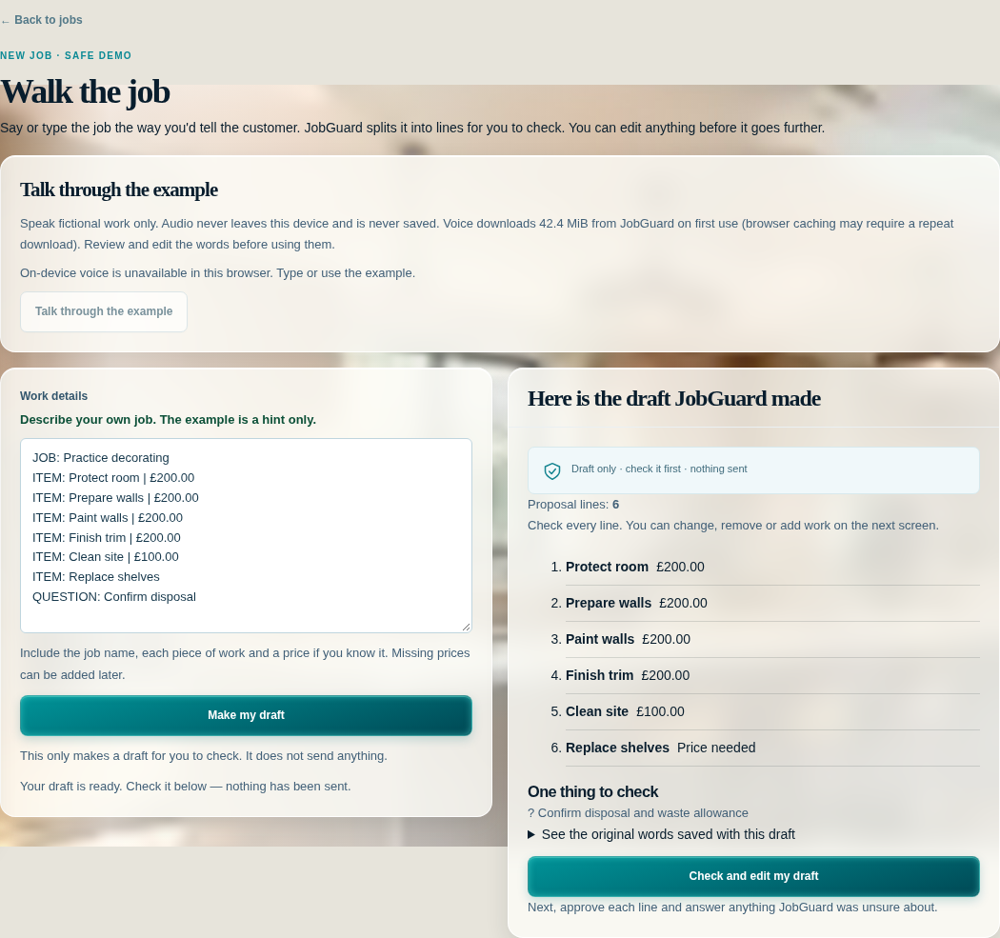](desktop-capture.png) | [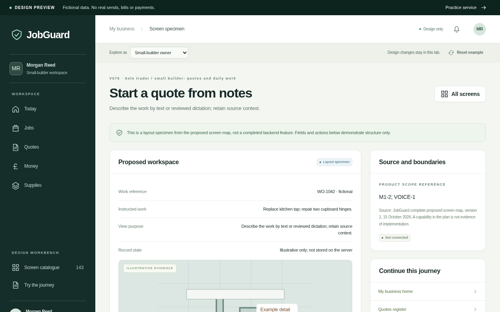](desktop-reference-capture.png) |
| Scope review | [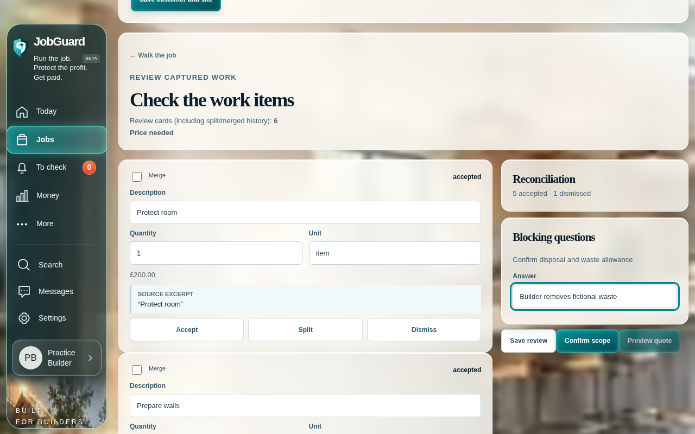](desktop-scope-review.png) | [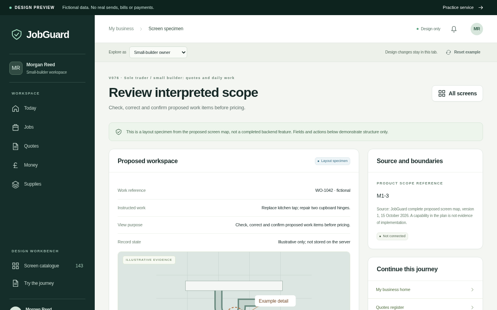](desktop-reference-scope-review.png) |
| Scope confirmed | [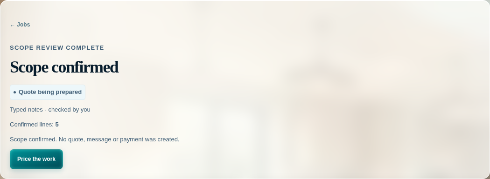](desktop-scope-confirmed.png) |  |
| Customer and site | [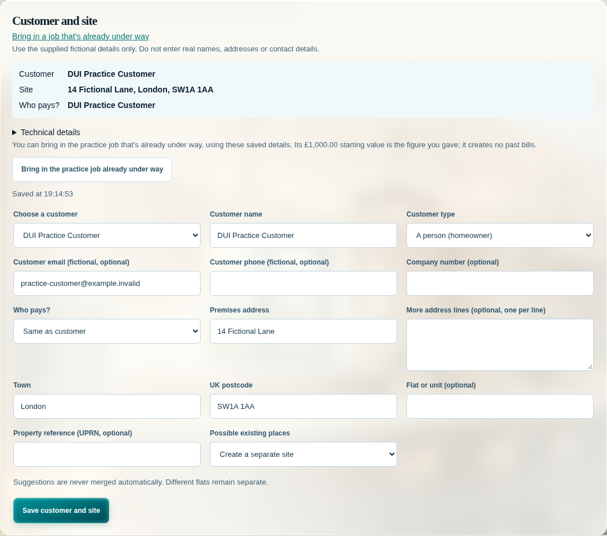](desktop-customer-and-site.png) | [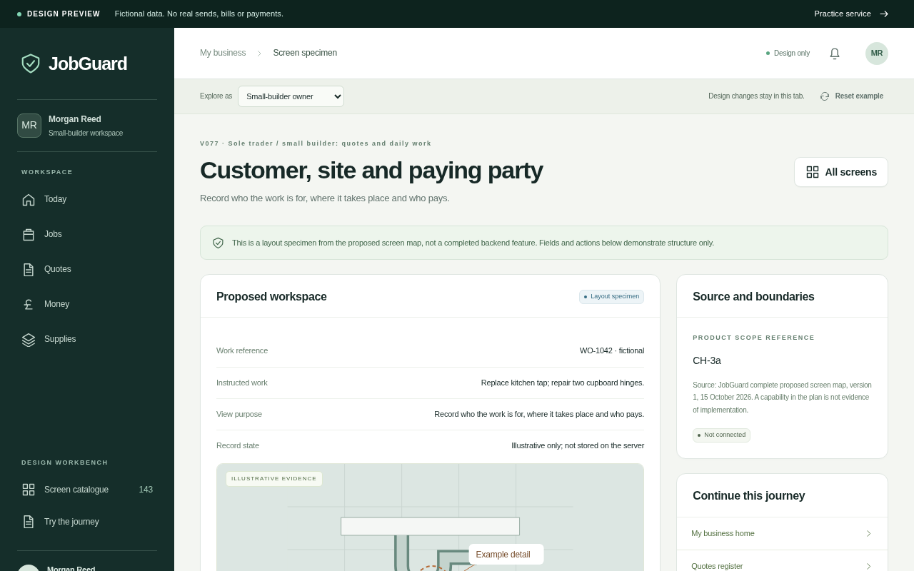](desktop-reference-customer-and-site.png) |

The Quotes companion shows the [mobile](mobile-360-reference-quotes.png) and [desktop](desktop-reference-quotes.png) notes and customer-summary patterns that informed capture and the saved details.

The three composed states are recorded in [AGENT_CHOICES.md](../../../../../AGENT_CHOICES.md).
